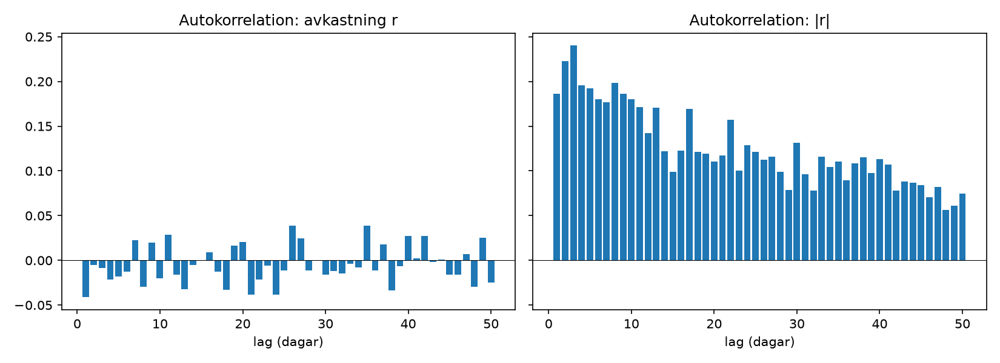

# Forecasting Volatility on the Stockholm Stock Exchange

**Can machine learning predict how much a stock will move better than classical econometric models like GARCH?**


<!-- Byt ut mot resultatgrafen när steg 4 är klart -->


## Motivation
Stock returns are close to unpredictable, but the *size* of price movements is not: calm periods tend to follow calm periods and turbulent ones follow turbulent ones (*volatility clustering*). Volatility forecasts are central to risk management, option pricing and portfolio construction.

This project compares simple baselines, GARCH and machine learning models for forecasting 5-day volatility of OMXS30 and large Swedish stocks, using a strict walk-forward evaluation to avoid look-ahead bias.

## Roadmap
- [x] **1. Data & exploration** – returns, realized volatility, evidence of clustering ([notebook](notebooks/01_data.ipynb))
- [ ] **2. Baselines** – naive, EWMA, GARCH(1,1) + walk-forward evaluation
- [ ] **3. ML models** – linear (HAR), random forest, gradient boosting
- [ ] **4. Results & analysis**
- [ ] **5. Interactive demo** (Streamlit)

## Key results
*Coming after step 4.*

## Approach
1. **Data:** daily prices for OMXS30 and five large-cap Swedish stocks (2010–today) from Yahoo Finance.
2. **Target:** realized volatility over the next 5 trading days, annualized.
3. **Models:** naive baseline, EWMA, GARCH(1,1), linear regression and tree-based ML models.
4. **Evaluation:** walk-forward validation – every forecast uses only data available at that point in time.

## Getting started
```bash
git clone https://github.com/<username>/volatility-forecasting.git
cd volatility-forecasting
python -m venv .venv
source .venv/bin/activate        # Windows: .venv\Scripts\activate
pip install -r requirements.txt
jupyter lab
```
Data is downloaded automatically on the first run and cached in `data/`.

## Project structure
```
src/data.py      data loading, returns, volatility, target variable
notebooks/       one notebook per step
data/            downloaded data (not tracked by git)
docs/images/     figures used in this README
```

## Tech stack
Python · pandas · NumPy · Matplotlib · yfinance

## Author
**Adam** – Computer Science, KTH
[LinkedIn](https://linkedin.com/in/...) · [GitHub](https://github.com/...)
